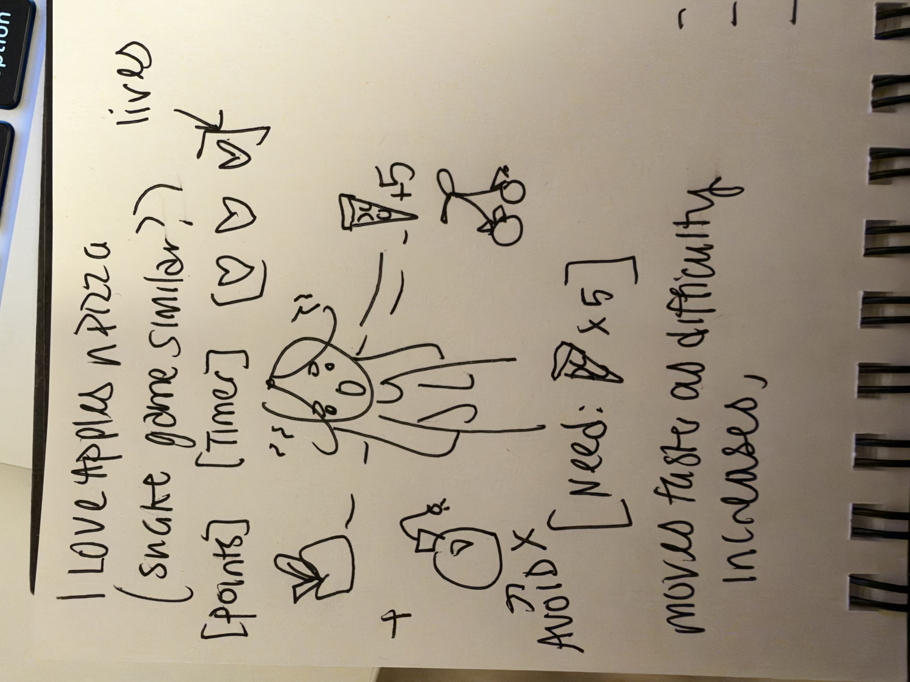

After thinking more about my two potential ideas, I decided to revisit my Week 9 assignment, I Love Apples and Pizza. I think there is still a lot I could explore with this assignment, and I want to take inspiration from Fruit Ninja to develop my existing sketch into a more entertaining arcade style game.

## Option 1: I Love Apples and Pizza (Week 9 HW Assignment)

[Original Assignment](../week9/index.html)

### Concept Sketch

### 1. Assignment I am revisiting

I am revisiting Week 9 assignment on gestural interaction, I created a small game using ml5.js and FaceMesh where users could eat apples and pizza by opening their mouths in front of a webcam. I had a lot of fun working on this assignment because I thought it was interesting to interact with a game without having to use a keyboard or mouse. I liked being able to play this with my friends when we were bored, even after the assignment was finished. I also think there is a lot of potential to make the game more entertaining.

### 2. How I plan to change my previous work

I plan to take my existing sketch and develop it into something that feels more like an actual arcade game. I thought about Fruit Ninja and how food is thrown into the air from different directions and how users have to react quickly. Instead of slicing the food, users would have to move their heads and open their mouths to catch the food. I am thinking about adding different types of food with different point values, rather than all foods having one food point value. I also want to experiment with how some foods moves since I think having the food thrown into the air and falling back down would make the game more interesting. I want to create a proper starting screen and game over screen too!

Aesthetics wise, I would like to go for a cute pixel art style since pixel art and animation were things I enjoyed working with growing up. After working with sound in my recent assignments, I also want to incorporate sound effects to give the game a little more life. I think it would be funny to have different reactions without it feeling a little too redundant.

### 3. What I need to do and expected challenges

I need to work from my existing code and continue using p5.js and ml5.js and adding p5.sound. I think one of the bigger challenges would be figuring out how to manage the different stages of the game and making sure the difficulty and scoring system are balanced. I also want to experiment more with facial tracking since I want the interaction to feel more responsive (maybe adding blinking as a challenge?). Another thing I would need to explore is incorporating pixel art assets I will make. Overall, it is definitely challenging to try to incorporate and tie everything together, but I think it will be super fun and rewarding.

### References
- [Fruit Ninja](https://www.halfbrick.com/games/fruit-ninja-classic_)
- [ml5.js](https://ml5js.org/)
- [p5.js](https://p5js.org/)
- [Freesound](https://freesound.org/)
- [Pixel Art Food Assets](https://itch.io/game-assets/tag-food/tag-pixel-art)
